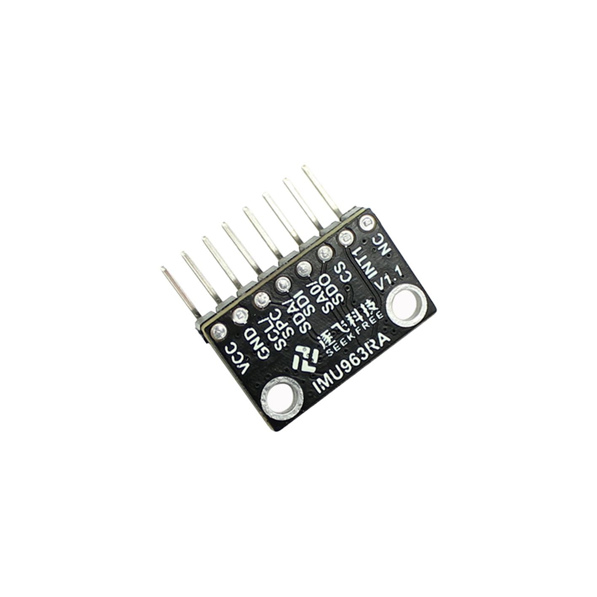

# 逐飞科技IMU963RX资料

#### 介绍
逐飞科技针对需要使用姿态传感器的应用场景，精心制作了不同型号的9轴传感器，所使用的芯片有意法半导体LSM6DSRTR、矽睿QMC5883L。

#### 学习套件
IMU963RX九轴:[点击此处购买](https://item.taobao.com/item.htm?id=673982106074&skuId=5023960991636)。

#### IMU963RX

#### 基础参数

1. **型号**：九轴加速度计陀螺仪磁力计IMU963RA
2. **九轴芯片型号**：STLSM6DSR
3. **地磁计芯片型号**：QMC5883L
4. **颜色**：黑白色系
5. **重量**：约2.6g
6. **供电电源**：3.3V-5V(自带LDO稳压芯片)
7. **通信方式**：支持1C和SPI(硬件SPI可达10M波特率)
8. **陀螺仪范围**：士125DPS、士250DPS、士500DPS、士1000DPS、士2000DPS、士4000DPS
9. **加速度范围**：士2G、士4G、士8G、士16G
10. **磁力计范围**：2G、8G

#### 传感器优势

该模块属于新一代的传感器，陀螺仪零偏和温漂小于ICM20602，该模块使用硬件SPI可以达到10M速率
